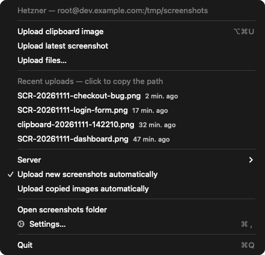
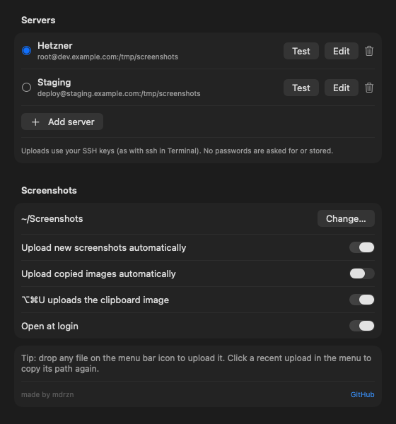

# 📸 Claude Screenshot Uploader

Take a screenshot on your Mac, get a path you can paste straight into a remote Claude Code session.


> 🪟 **On Windows?** The Windows equivalent is at [**mdrzn/windows-screenshot-uploader**](https://github.com/mdrzn/windows-screenshot-uploader).

<table>
<tr>
<td valign="top"></td>
<td valign="top"></td>
</tr>
</table>

## 🤔 Why

When Claude Code runs on a remote server over SSH, it can read files on *that* server — not the image sitting on your Mac's desktop. Pasting a screenshot into the terminal does nothing useful, so you end up repeating the same four steps by hand: save the image, `scp` it up, work out where it landed, type the path.

Screenshot Uploader collapses that into one step. Your screenshot ends up on the server and its remote path ends up on your clipboard, so the only thing left to do is paste.

```
You: have a look at this — /tmp/screenshots/SCR-20261111-checkout-bug.png
Claude: [reads the image]
```

## ✨ Features

- ⚡ **Instant** — a small native menu bar app; macOS tells it the moment a screenshot is saved. No polling, no delay, ~0% CPU when idle.
- 📋 **Clipboard images** — copied a screenshot instead of saving it (Shottr, CleanShot, ⌃⇧⌘4)? Press **⌥⌘U**, or turn on automatic upload of copied images.
- 🗂️ **Any file** — drop files on the menu bar icon, or pick them with *Upload files…*.
- 🕘 **Recent uploads** — the last uploads in the menu; click one to copy its path again.
- 🖥️ **Multiple servers** — add, edit and **test** SSH connections in Settings, switch from the menu.
- 🔒 **SSH keys only** — `rsync` over SSH with your existing keys; no passwords asked for or stored. The remote folder is created if it's missing.
- 🔔 **Notifications** — for every upload, including failures, so nothing fails silently.
- 🗑️ **Optional cleanup** — move the local copy to the Trash after uploading, per server.
- 🇮🇹 English and Italian (follows the system language).

## 🚀 Install

**Homebrew**

```sh
brew tap mdrzn/tap && brew trust mdrzn/tap
brew install --cask --no-quarantine mdrzn/tap/screenshot-uploader
```

**Download** — get `ScreenshotUploader.zip` from the [latest release](https://github.com/mdrzn/claude-screenshot-uploader/releases/latest), move **Screenshot Uploader.app** to Applications and open it.

The app is free and open source but not notarized by Apple, so the first launch is blocked: click **Done**, open **System Settings → Privacy & Security** and click **Open Anyway** (or run `xattr -dr com.apple.quarantine "/Applications/Screenshot Uploader.app"`). Installing with `--no-quarantine` skips this.

**Build it yourself** — needs only the Xcode Command Line Tools:

```sh
git clone https://github.com/mdrzn/claude-screenshot-uploader.git
cd claude-screenshot-uploader/app && ./build.sh && open "Screenshot Uploader.app"
```

## 📸 Usage

1. Open **Settings…** from the menu bar icon, add a server and click **Test**.
2. Take a screenshot — it's uploaded right away and the remote path is on your clipboard.
3. Paste the path into Claude Code.

| To… | Do |
|:--|:--|
| Upload a copied image | **⌥⌘U**, or *Upload clipboard image* in the menu |
| Upload any file | Drop it on the menu bar icon, or *Upload files…* |
| Re-copy a path | Click it under *Recent uploads* |
| Switch server | *Server* in the menu |
| Upload from a script | `"/Applications/Screenshot Uploader.app/Contents/MacOS/ScreenshotUploader" --upload file.png` (prints the remote path) |

Any image or video saved in the watched folder counts (`.png`, `.jpg`, `.heic`, `.gif`, `.mov`…), so it works with the built-in macOS capture as well as Shottr, CleanShot and others, whatever they name their files.

## 🔧 Configuration

Settings are stored in `~/.claude-screenshot-uploader/config.json` (you normally edit them in the app):

```json
{
  "active": "main",
  "local_screenshots": "/Users/you/Screenshots",
  "servers": {
    "main": { "name": "Production", "host": "example.com", "user": "root", "path": "/tmp/screenshots", "auto_delete": false }
  }
}
```

### 🔑 SSH keys

Uploads never prompt for a password, so key authentication has to work first:

```bash
ssh-keygen -t ed25519          # if you don't already have a key
ssh-copy-id you@example.com
ssh you@example.com "echo ok"  # should print ok without asking for anything
```

A host's key is trusted on first contact and pinned after that, so if it later changes the upload fails loudly instead of going through quietly. The **Test** button in Settings runs the same check.

## 🐛 Troubleshooting

- **Upload failed** — click **Test** next to the server: the error from `ssh` is shown there. Usually the key isn't installed on the server (`ssh-copy-id`) or the host is unreachable.
- **Nothing happens after a screenshot** — check the watched folder in Settings matches where your screenshots are saved (*Screenshot app → Options → Save to*, or your tool's setting), and that *Upload new screenshots automatically* is on.
- **No notifications** — allow them for Screenshot Uploader in *System Settings → Notifications*.

## 🧰 Upgrading from v3 (shell + xbar)

Version 4 reads the same `config.json`, so your servers carry over. On first launch it offers to turn off the old version: its LaunchAgent and xbar plugin are moved to `~/.claude-screenshot-uploader/legacy-backup` (not deleted), and you can uninstall xbar if you don't use it for anything else.

The shell version now lives in [`legacy/`](legacy) for reference, and ready to use on the [`v3-shell`](https://github.com/mdrzn/claude-screenshot-uploader/tree/v3-shell) branch and the [v3.1.0](https://github.com/mdrzn/claude-screenshot-uploader/releases/tag/v3.1.0) release. If you run *Update* from the old menu, it now shows a notice pointing to the native app.

## 📄 License

MIT — made by [mdrzn](https://github.com/mdrzn).
